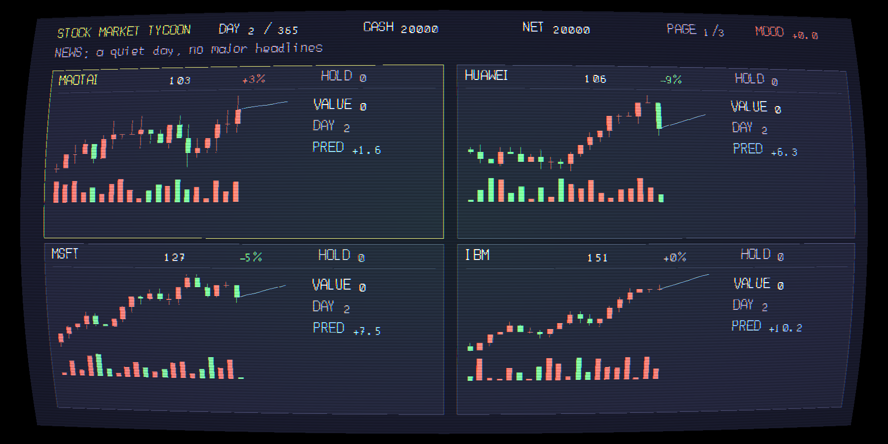
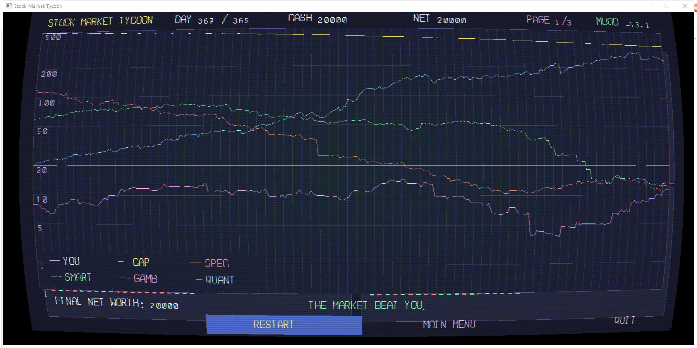
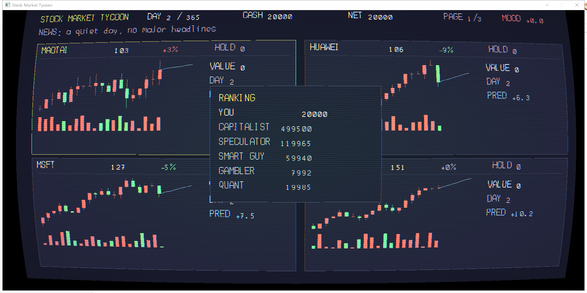
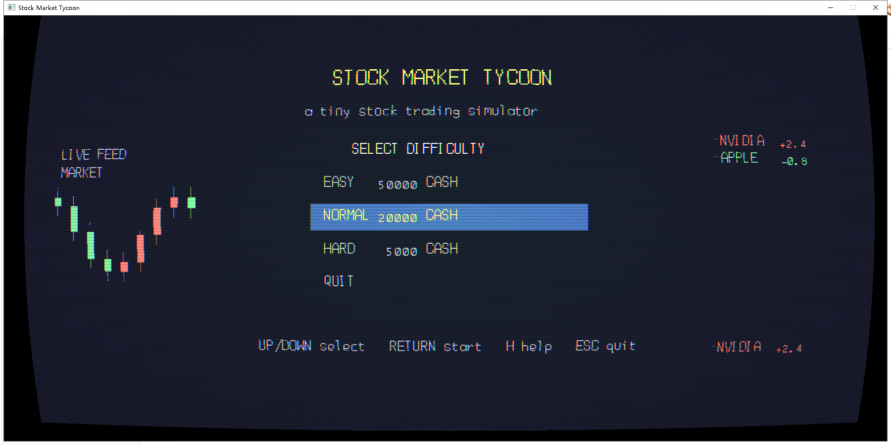

# Stock Market Tycoon

用 **MoonEngine 2.2.20.0** 写的股票模拟游戏。C 语言，单一的 `StockMarketTycoon.exe`，不依赖脚本运行时；引擎源码随项目附带在 `engine\` 里。

界面是四分屏行情：K 线、成交量、预测线，右侧持仓与当日预测；顶部是日期、现金、净值、页码和情绪。255 天到一年，看你能不能在均值回归和突发新闻里活下来。



## 关于这个项目

这是一个实验性的小游戏。底层的框架、规则与设计思路由我提供，程序实现（C 代码、训练脚本、文档）由 AI 协助完成，我负责提需求、改规则和验收。

它的目的是验证两件事：MoonEngine 2.2.20.0 在"小体量、强状态"的场景下能不能撑住，以及把一个小型神经网络直接编进游戏、当作 NPC 的对手是否可行。
## 玩法

| 按键 | 作用 |
|---|---|
| `↑` `↓` | 在 2×2 网格里换行 |
| `←` `→` | 行内换列，到边缘翻页 |
| `Q` `E` | 直接翻页 |
| `回车` | 进入下一个交易日 |
| `1` `2` | 买 1 股 / 卖 1 股 |
| `3` `4` | 买 50 股 / 卖 50 股 |
| `5` `6` | 全买 / 全卖 |
| `TAB` | 排行榜（你与五个 NPC 的净值） |
| `H` | 帮助 |
| `ESC` | 暂停菜单（继续 / 重开 / 主菜单 / 帮助 / 退出） |

主菜单选难度：EASY 起手 50000、NORMAL 20000、HARD 5000，难度越高日波动越大。



## 市场规则

每天的价格变化按下面几项叠加（百分比）：

```
change = rand(-v, v+1) + 情绪漂移 + 个股偏好
       + 动量（昨天涨跌的 3%）
       - 均值回归（偏离 20 日均线的 20%）
       + 新闻影响 + 交易冲击
```

- `v` 由难度（3/5/7）和个股波动倍率（0.7~2.0）决定；
- 情绪由新闻推动，正的时候全市场偏涨；
- 新闻分四类：公司特色、通用利好/利空、宏观（全市场）、黑天鹅（单只 −20%~−50%）；
- 价格跌破 0 视为退市：持仓清零不返还，价格重置回基准价；
- 买卖收 0.3% 手续费，大额交易会给下一交易日留下反向压力。

## NPC

五个对手各有打法：

- **CAPITALIST**：每 3 天用 10% 现金随机买入，只买不卖；
- **SPECULATOR**：追涨杀跌，读新闻；
- **SMART GUY**：低于 20 日均价买，高于 3% 卖一半；
- **GAMBLER**：45% 概率全仓、否则清仓；
- **QUANT**：神经网络，12 维特征预测次日涨跌，按预测分配仓位，每天向目标挪三分之一，每 30 天拿出净值的 2% 分给其他 NPC。



## 编译

需要 Visual Studio（MSVC），引擎已经随项目附带（`engine\`），不用另外准备：

```
C:\Users\<you>\Desktop\
  ├─ moon2.0\          引擎源码与库
  └─ C\stock-moon\     本项目
```

在项目根目录运行 `build.bat`，产物在 `build\`，可直接分发的内容会被复制到 `dist\`（exe + SDL3.dll + glfw3.dll）。

## 目录结构

```
stock-moon/
  build.bat        编译脚本
  src/             游戏源码（C）
  engine/          随项目附带的 MoonEngine 2.2.20.0（include/ 与 lib/）
  tools/           Python 训练与自测脚本
  docs/            截图
  dist/            可直接分发的 exe 与依赖
  _archive/        历史补丁脚本、数据集、旧截图
```

## 神经网络（可选）

`QUANT` 的权重编译在 `src/nn_weights.h` 里，运行时不需要 Python。想重新训练：

```bash
cd tools
python train_nn_dll.py      # 采集数据、训练、导出 nn_weights.h
```

它需要先编译 `sim.dll`（`tools/build_sim.bat`），训练和游戏用的是同一份市场规则。

## 许可

个人项目，随引擎一起使用。



## 许可

本项目以 MIT 许可发布，详见 [LICENSE](LICENSE)；随附引擎与第三方组件（SDL3、GLFW、glad、stb）的许可见 [THIRD_PARTY_NOTICES.md](THIRD_PARTY_NOTICES.md)。
